# LockMyHealth — Your Health, Connected


## Demo Video:

[Watch Demo](./demo_video.mp4)

## 1. Problem Statement

LockMyHealth is a patient-controlled digital health locker designed to address the problem of fragmented medical records and repeated care across healthcare providers.

Patients often visit multiple hospitals, clinics, and diagnostic centers, resulting in medical information being scattered across prescriptions, laboratory reports, scan results, and consultation notes. This fragmentation makes it difficult to access a complete medical history, potentially leading to repeated tests, incomplete clinical context, and delays in treatment.

LockMyHealth brings these records together in one organized digital space, helping patients maintain a connected view of their health journey. It puts patients in control of their medical information and makes relevant records easier to access and share when needed.

Our vision: One patient. One connected health story.

---

## 2. Solution Overview

**LockMyHealth** provides a centralized, patient-controlled platform to organize medical records, understand health history, and simplify information sharing with healthcare providers.

1. **One Medical Locker:** Keep all prescriptions, test reports, scans, and hospital papers safely in one place.

2. **Chronological Health Timeline:** See your medical history in order, like a story of your health over time.

3. **Provider Folders (My Doctors):** Organize records by doctor or clinic, without duplicates.

4. **Smart Medicine Check:** Spot repeated prescriptions, wrong dosages, or confusing instructions, so you can ask clear questions at your next visit.

5. **Lab Trends:** Charts that show how your test results (like sugar or cholesterol) change over time, with easy explanations.

6. **Auto Document Reading:** The system reads your reports and pulls out key details, but you confirm them.

7. **Ask Assistant:** A chatbot that answers questions using your own uploaded documents, with references, but without giving medical advice.

8. **Visit Prep("Prepare for My Next Visit"):** Creates a one‑page summary for your next doctor visit, ready to print or share.
      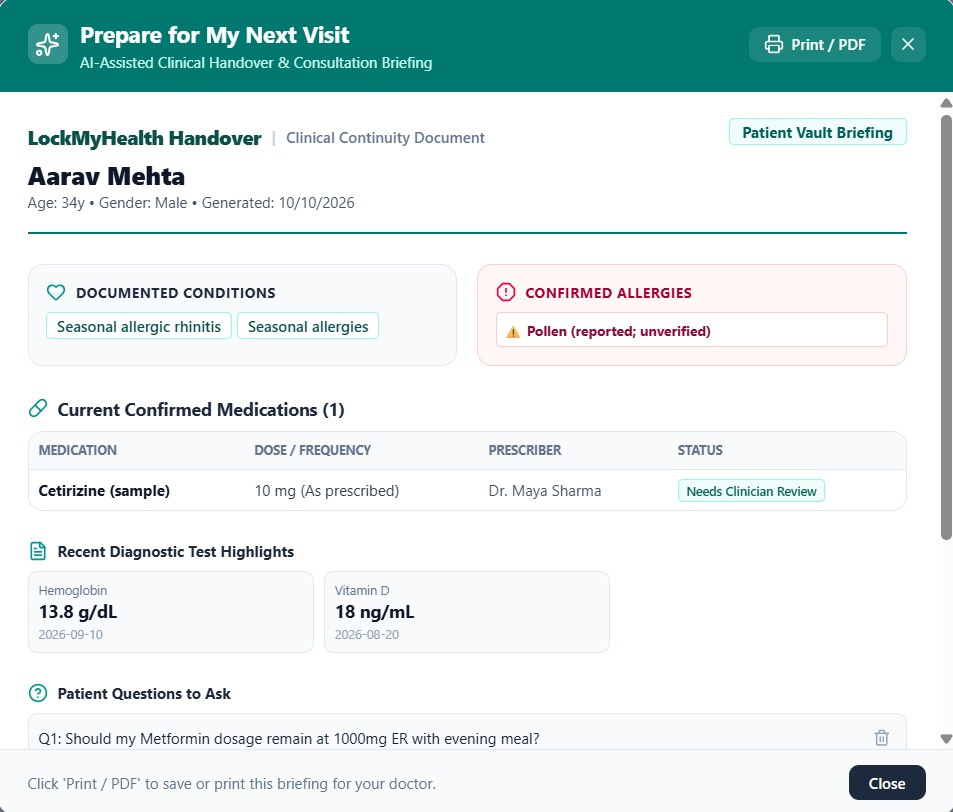

9. **Safe Sharing:** Share your records with a doctor using a secure link that you can cancel anytime.

10. **Emergency Card:** Quick‑access card with your allergies, blood group, medicines, and doctor contacts — digital or printable.


_Note: LockMyHealth utilizes realistic synthetic medical datasets for demonstration. No real protected health information (PHI) or live hospital integrations are required._

---

## 3. Tech Stack & Dependencies

| Layer               | Technologies                                                   | Purpose                                                                |
| ------------------- | -------------------------------------------------------------- | ---------------------------------------------------------------------- |
| **Frontend**        | React 19, TypeScript, Tailwind CSS v4, Lucide React, Motion    | Responsive, calm teal/sea-glass healthcare UI                          |
| **Backend API**     | Node.js, Express, TSX                                          | Full-stack server endpoints, security boundary, file upload processing |
| **AI Engine**       | `@google/genai` (Gemini 3.8 Flash)                             | AI chatbot, grounded RAG Q&A, lab explanations                         |
| **Storage & DB**    | Persistent JSON store with atomic writes & Multer disk storage | User-isolated records, metadata vault, uploaded PDF/image handling     |
| **Build & Tooling** | Vite 8, TypeScript 7                                           | Zero-bundle-leakage production builds and live dev server              |

---

## 4. Key Screenshots & Interfaces

_(Placeholders for hackathon repository submission video/screenshot assets)_

- **Login Page:**
  • Secure sign‑in for patients
  • Easy access to personal health records

    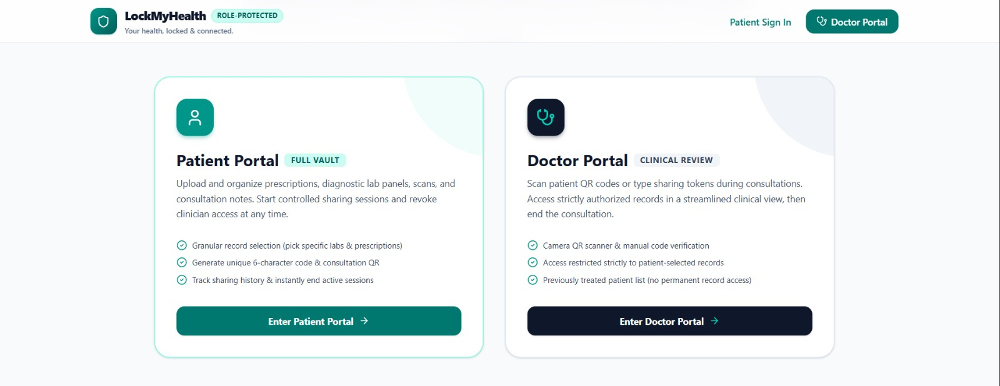

- **Overview:**
  • Quick snapshot of health status
  • Highlights recent reports, medicines, and appointments
      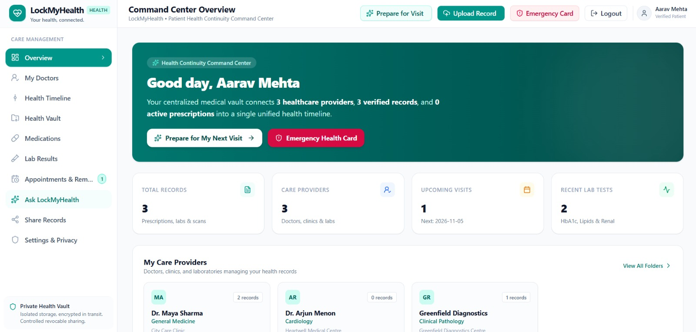
    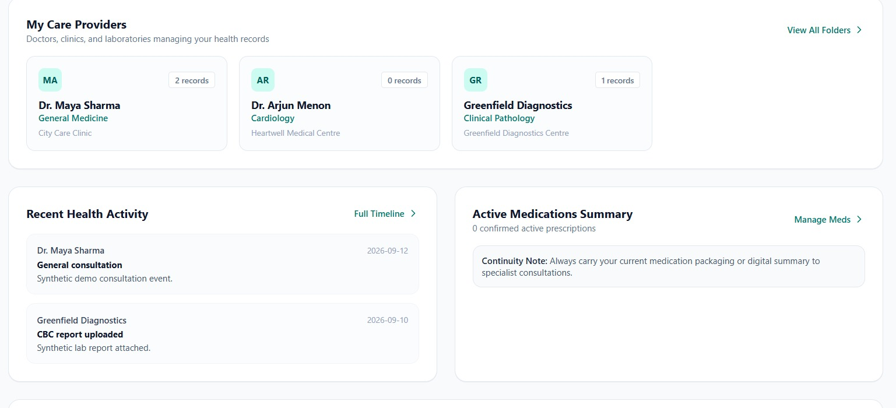


- **My Doctors:**
  • Organized folders by doctor/clinic
  • Easy to find past prescriptions and notes
      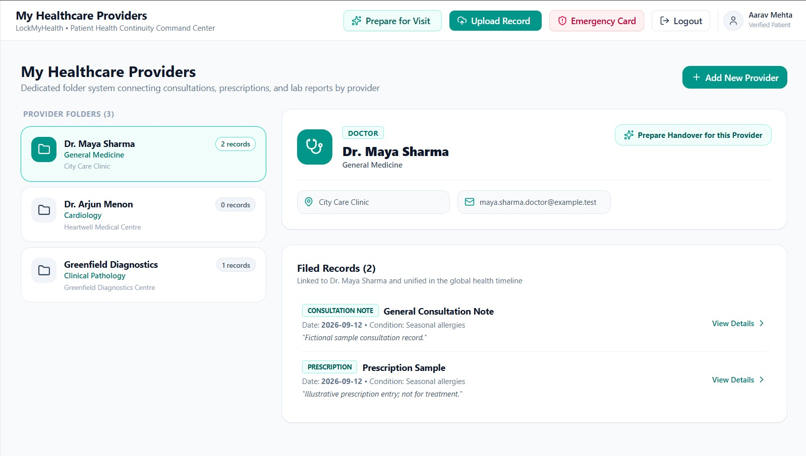
          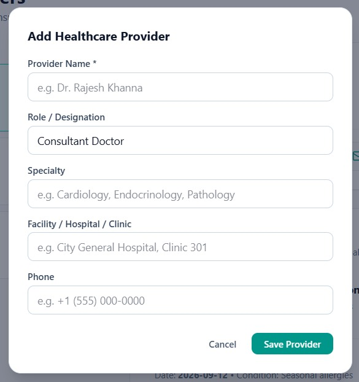


- **Health Timeline:**
  • Medical events shown in order
  • Helps track health progress over time
      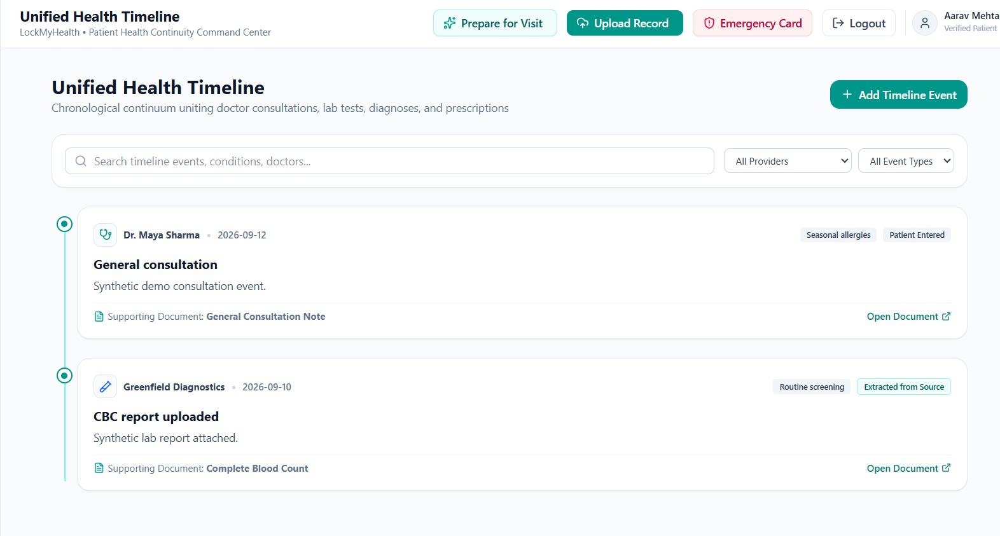
    


- **Health Vault**
  • Central storage for all medical documents
  • Safe and searchable
      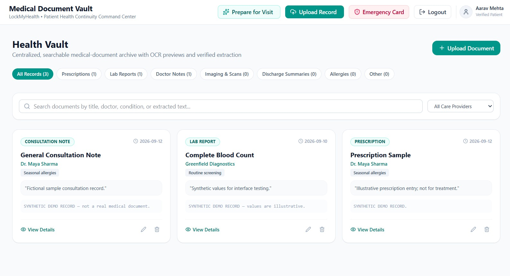


- **Medication Reconciliation Center:**
  • Detects duplicate or conflicting prescriptions
  • Prepares questions for doctor visits
        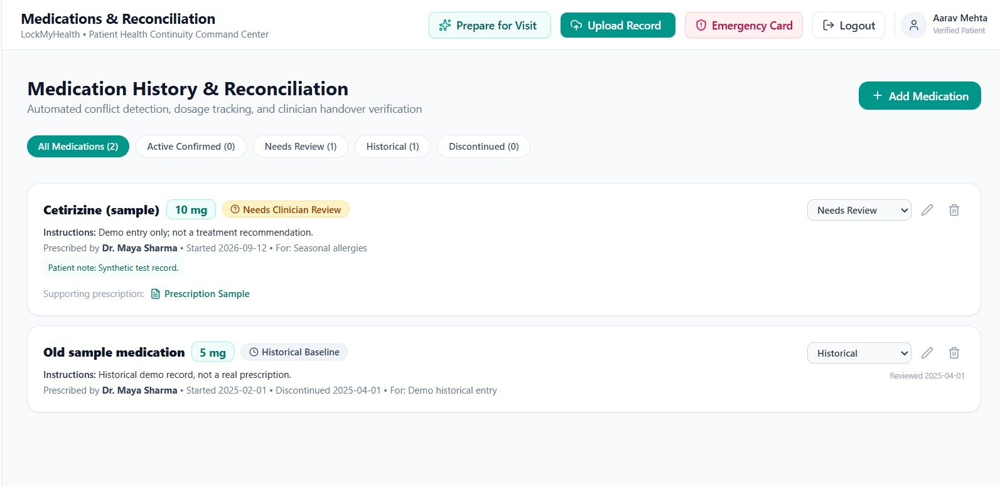

  
  

- **Lab Results:**
  • Charts showing test trends (sugar, cholesterol, etc.)
  • Clear explanations with reference ranges
        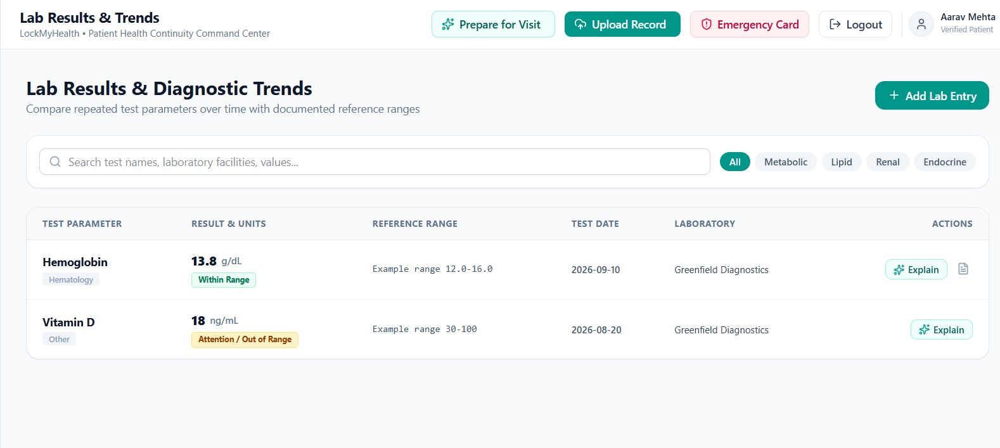

  

- **Appointments and Remainders**
  • Schedule upcoming visits
  • Get timely reminders and alerts
        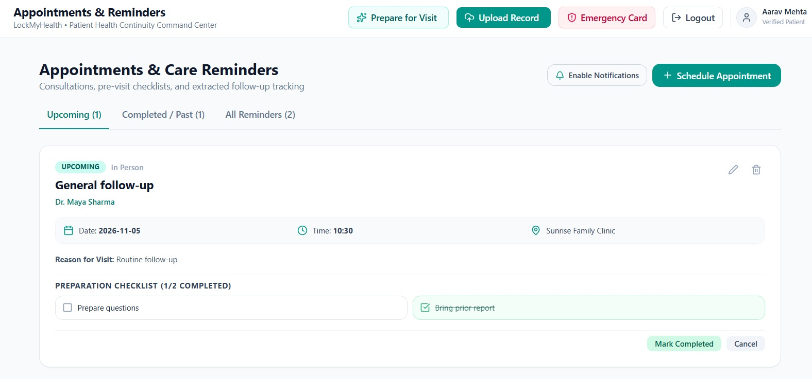


- **Ask LockMyHealth:**
  • Chatbot answers questions using your records
  • Provides source‑based responses, not medical advice
        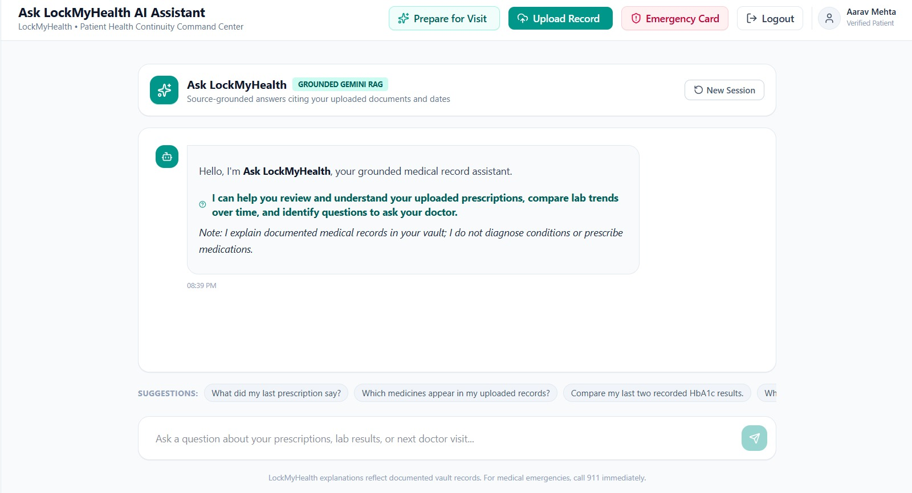


- **Share Records**
  • Secure links for doctors
  • Patient can control access and revoke anytime
        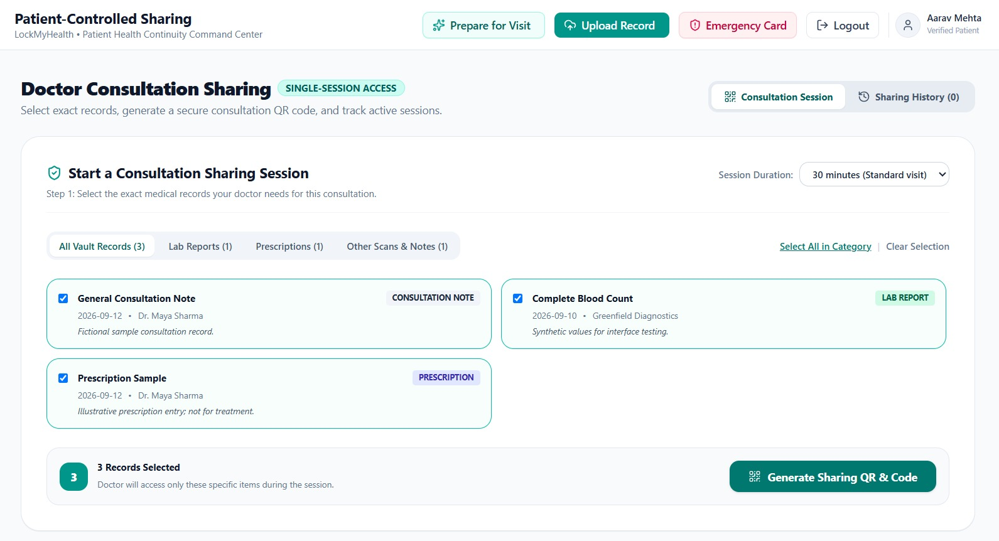


- **Emergency Health Card:**
  • Quick‑access card with allergies, blood group, medicines
  • Digital and printable for emergencies
        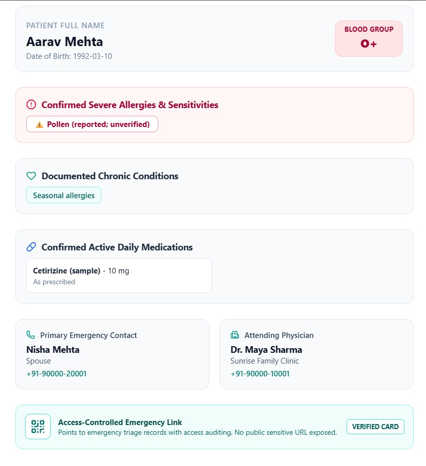


---

## 5. Local Setup Instructions

### Prerequisites

- Node.js v20+ or v22+
- npm v10+
- A Google Gemini API key

### Installation Steps

1. **Clone the repository:**

   ```bash
   git clone https://github.com/<your-username>/LockMyHealth.git
   ```

2. **Install dependencies:**

   ```bash
   npm install
   ```

3. **Configure Environment Variables:**
   Create a `.env` file in the project root:

   ```env
   GEMINI_API_KEY="your_gemini_api_key_here"
   PORT=3000
   NODE_ENV=development
   ```

4. **Run the Development Server:**

   ```bash
   npm run dev
   ```

   Open [http://localhost:3000](http://localhost:3000) in your browser.

5. **Run the Automated Test Suite:**

   ```bash
   npm run test
   ```

6. **Build for Production:**
   ```bash
   npm run build
   npm start
   ```

---

## 6. Synthetic Demo Account Instructions

LockMyHealth includes an instant, zero-setup synthetic patient sandbox:

- **Patient Name:** Aarav Sharma (34 years old, Male)
- **Chronic Conditions:** Seasonal allergies
- **Providers Connected:**
  - Dr. Maya Sharma (General Medicine — CIty Care Clinic)
  - Dr. Arjun Menon (Cardiologist — HeartWell Medical Centre)
  - Greenfield Diagnostics (Laboratory Pathology)
- **How to explore:**
  - Open the app; synthetic demo mode loads automatically.
  - Click **"Reset Demo Data"** in the top banner at any time to return to baseline.
  - Click **"Switch / New Account"** to test a blank patient workspace.

---

## 7. Testing Commands and Observed Outcomes

Run the comprehensive business-logic suite:

```bash
npm run test
```

### Verified Test Results (40 Passed, 0 Failed across 2 Suites):

- `[PASS]` Demo user exists with correct profile
- `[PASS]` New isolated user created
- `[PASS]` Data isolation: New user has 0 documents initially
- `[PASS]` Demo user has synthetic records populated
- `[PASS]` Document created with stable ID prefix
- `[PASS]` Document listed correctly
- `[PASS]` Document updated successfully
- `[PASS]` Document deleted successfully
- `[PASS]` Document removed from user collection
- `[PASS]` Timeline events exist
- `[PASS]` Timeline events ordered chronologically descending (newest first)
- `[PASS]` Medication reconciliation detected conflicts in synthetic data
- `[PASS]` Medication engine detected dose change or active vs discontinued status
- `[PASS]` Appointment created
- `[PASS]` Appointment rescheduled with updated date/time
- `[PASS]` Share token is unguessable and properly formatted
- `[PASS]` Valid share token grants active read-only access
- `[PASS]` Share scoping enforced: only prescriptions returned
- `[PASS]` Revoked share token is immediately rejected
- `[PASS]` Non-existent token rejected safely
- `[PASS]` Security boundary: User cannot access records belonging to another patient
- `[PASS]` Emergency card contains patient name
- `[PASS]` Emergency card contains confirmed allergies
- `[PASS]` User isolation: Initial state of separate users is clean
- `[PASS]` Record creation: Upload record for User Alpha
- `[PASS]` Security boundary: User Beta CANNOT view User Alpha document
- `[PASS]` Security boundary: User Beta CANNOT delete User Alpha document
- `[PASS]` Persistence: Re-reading from disk file preserves newly created record
- `[PASS]` Reminders: Create appointment with preparation checklist
- `[PASS]` Reminders: Reschedule appointment updates date and status
- `[PASS]` Reminders: Mark appointment completed
- `[PASS]` Medication Reconciliation: Detects dose conflict when multiple active doses exist
- `[PASS]` Share Grants: Generates unguessable token with scoped categories
- `[PASS]` Share Grants: Active token returns scoped records only
- `[PASS]` Share Grants: Access event logged in audit trail
- `[PASS]` Share Grants: Immediate revocation rejects access with revoked status
- `[PASS]` Share Grants: Non-existent token returns not_found status
- `[PASS]` Emergency Card: Update blood group and contact details
- `[PASS]` Handover Summary: Structured briefing includes conditions, allergies, and medications
- `[PASS]` Data clean-up: Delete document and ensure associated state cleaned up

---

## 8. Third-Party Libraries & Services Used

- `@google/genai`: Official SDK for Gemini 3.8 Flash model invocation (server-side only).
- `express`: Server framework for routing, authentication middleware, and static asset delivery.
- `multer`: Multipart form-data parser with disk storage limits and MIME-type filtering.
- `lucide-react`: Accessible, clinical healthcare iconography.
- `tailwindcss`: Design tokens and calm teal/sea-glass styling.
- `tsx`: Node.js TypeScript execution runtime.

---

## 9. Known Limitations & Future Work

- **Direct EHR Standards (FHIR / HL7):** Currently ingests PDFs and structured JSON; future iterations can connect to SMART on FHIR endpoints.
- **Offline PWA Sync:** Progressive Web App service worker caching for offline medication viewing during cellular dead zones.
- **Biometric Auth:** WebAuthn Passkeys for biometric device authentication before viewing emergency cards.

---

© 2026 LockMyHealth Team. Built for the Google AI Studio Hackathon.
